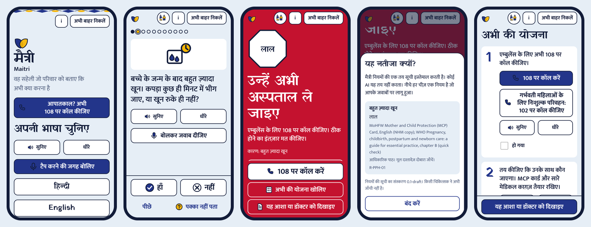

<div align="center">

# Maitri (मैत्री)

## The Friend Who Answers When It Matters Most

**Voice-first maternal emergency guidance for every family**

*Speak it. See why. Call at once.*


**Team Decyphers** · Aafreen Khan (team leader) · Aastha Pandya · Prisha Sharma
recHERsion 2026 · Problem Statement 1: Women's Healthcare

[**Live app**](https://aafreenzy.github.io/maitri/) · [**Demo video**](docs/demo/maitri-demo.mp4) · [**Presentation**](docs/Maitri-recHERsion-2026-final.pptx) · [**Pitch and full explanation**](docs/PITCH_AND_EXPLANATION.md) · [**Story script**](docs/PITCH_STORY_SCRIPT.md)



</div>

> [!IMPORTANT]
> Maitri is an education tool. It does not diagnose and cannot replace a health worker. The rules are a draft and have **not yet been reviewed by a clinician**. See [Honest limitations](#honest-limitations).

---

## Contents

1. [The problem](#1-the-problem)
2. [What we are solving](#2-what-we-are-solving)
3. [How Maitri solves it](#3-how-maitri-solves-it)
4. [Our five distinguishing features](#4-our-five-distinguishing-features)
5. [How we are different, and what we do better](#5-how-we-are-different-and-what-we-do-better)
6. [A two-minute tour for judges](#6-a-two-minute-tour-for-judges)
7. [How the decision is made](#7-how-the-decision-is-made)
8. [Trust and evidence](#8-trust-and-evidence)
9. [Run it](#9-run-it)
10. [Optional backend](#10-optional-backend)
11. [Deploy](#11-deploy)
12. [Honest limitations](#honest-limitations)
13. [Roadmap](#roadmap)
14. [Credits](#credits)

---

## 1. The problem

> A warning sign appears in a pregnant or postpartum woman, such as heavy bleeding, a severe headache or reduced baby movement. Her family cannot tell whether it is routine or an emergency. They wait, they argue, they call the wrong person. **Those lost minutes, before anyone has asked for help, are the problem we solve.**

Maternal deaths are driven by three delays: **recognising** the danger, **deciding** to go, and **reaching** care. Maitri works on the first two, because they happen at home, before any hospital is involved.

| Figure | What it says | How sure we are |
|---|---|---|
| **25.2 million** | Births a year in India | Secondary source |
| **48.6 %** | Of maternal deaths in one Indian hospital study involved a delay in deciding or seeking care | Verified, **single study**, not a national figure |
| **1 in 3** | Women has fewer than four antenatal visits | Secondary, derived |

Every statistic in our materials carries a confidence label. The full list is in [`docs/PITCH_FACTS.md`](docs/PITCH_FACTS.md). We never present these figures as lives saved.

## 2. What we are solving

The knowledge of danger signs already exists. It is printed on the MoHFW Mother and Child Protection card and taught to every ASHA. What is missing is that knowledge **within reach at 11:40 at night, in the woman's own language, for a frightened family that may not read well and may share one phone.**

Maitri closes the gap between *knowing* the danger signs and *acting* on them in time.

## 3. How Maitri solves it

| Step | What the family does | What Maitri does |
|---|---|---|
| **1. Say it** | Taps the microphone and says what is happening, in Hindi or English. Or taps Yes, No, Not sure. | Turns speech into the same answers the buttons give. She sees what was understood and can remove any sign. |
| **2. See why** | Reads the result: a word, a shape and a colour together. | Shows the rule, the source and the rule version behind the result. No AI decides. |
| **3. Call at once** | Taps the large call button. | One RED sign ends the check immediately. A go-now plan follows, then a one-page slip for the nurse. |

The three result levels use **word + shape + colour**, so they still read in greyscale or bright sun:

| Level | Shape | Meaning |
|---|---|---|
| 🔴 **RED** | Octagon | Go to the hospital now. |
| 🟠 **AMBER** | Triangle | See the ANM, ASHA or doctor today. |
| 🟢 **GREEN** | Circle | **"No danger sign told."** We never say "fine" or "safe", and the result always includes the go-if-worse line. |

## 4. Our five distinguishing features

| | Feature | The role it plays | Why it matters |
|---|---|---|---|
| 🎙️ | **1. Voice in, voice out** | Speech-to-text takes her answers by voice. Text-to-speech reads every question and result aloud, with a Slow option. | A frightened family cannot type. Tapping always works too. A spoken "No" is confirmed first, because a misheard "No" could hide a sign. |
| 📞 | **2. The call comes first** | The emergency call button is the first control on the first screen. One RED sign ends the check and shows a large call button. | No account, no question, nothing between the family and the ambulance number. |
| 🔍 | **3. It shows its work** | "Why this result?" lists the rule, the sign, the source and the rule version. The Trust page shows review status and test counts. | Anyone, including a clinician, can check the reasoning. The rules live in one file, `src/data/rules.json`. |
| 🧭 | **4. From panic to a plan** | A go-now plan (call, decide who goes, show the slip, ask about free transport and care under JSSK) and a one-page Maitri slip with the signs told and the time. | The family leaves knowing what to do next. The slip carries no name and no phone number, and is shared only after she agrees. |
| 🔒 | **5. Private, offline, for everyone** | Works offline after one visit. No account needed. "Exit now" clears everything and leaves the app. Hindi and English screens are audited by a test. | A shared phone, a weak signal and a bright room should not stop her. Nothing leaves the phone during the emergency check. |

Also included: **modes** for the woman, the ASHA or ANM (with an optional on-device list, off by default) and the family, and a **rule review page** where a clinician can mark rules reviewed and export an updated `rules.json`.

## 5. How we are different, and what we do better

Typical examples, and our own assessment from limited searching, not every product. A helpline gives real advice in Hindi, and a paper card is printed and auditable. The gap is that none of them does all of the following together.

| What the family needs | Paper card | Helpline | Symptom chatbot | **Maitri** |
|---|:---:|:---:|:---:|:---:|
| Works with no internet | ✅ | ❌ | ❌ | ✅ |
| Hindi: listens and answers aloud | ❌ | ✅ | ➖ | ✅ |
| Tells the family the next step | ➖ | ✅ | ➖ | ✅ |
| Shows why, with its sources | ✅ | ❌ | ❌ | ✅ |
| Hands a summary to the ASHA or doctor | ❌ | ❌ | ❌ | ✅ |

**What we do better**

- **Decision, not diagnosis.** Other tools tell a woman what her symptoms might mean. Maitri tells her family what to do in the next ten minutes.
- **Deterministic and auditable.** The same answers always give the same result. There is no model that can guess, and an independent Python implementation re-checks every rule.
- **Safe by design.** "Not sure" and skipped answers go **up**, never down. We accept an extra visit rather than a missed danger sign.
- **Private by design.** No analytics, no cookies, no tracking, no names. Answers stay in memory.
- **Honest about itself.** The Trust page lists review status ("none yet"), helpline status and what is simulated.

We do not claim to be the first or the only tool in this space.

## 6. A two-minute tour for judges

1. **First screen.** The emergency call button is the first thing on screen. Pick Hindi or English.
2. **Speak.** Tap "Speak instead of tapping", then the microphone. Say that the baby is born and there is heavy bleeding. Needs a phone browser with speech recognition and internet. Or choose family, "I had my baby", and answer Yes to heavy bleeding.
3. **One RED sign ends the check.** See the large call button, the go-now plan and the slip.
4. **Why this result?** See the rule, its source, and that no AI decides.
5. **About, then "How Maitri decides".** Sources, tests, review status, helpline status, data handling and what is simulated or not done.
6. **Try "Not sure".** The result goes up to AMBER, never to GREEN.

## 7. How the decision is made

The verdict is a deterministic rule engine in `src/engine`. The rules live in one file, `src/data/rules.json`, with a source for each. There is no AI, no network call and no randomness in the verdict.

- The **highest level** among the fired rules wins. If none fire, the result is GREEN ("No danger sign told").
- **"Not sure" and skipped answers escalate**, to at least AMBER for signs that matter.
- Two AMBER-class signs together become RED.
- The app shows **no numeric clinical thresholds**. Questions are in plain language.
- **Voice only turns spoken words into the same answers**, using word lists in `src/data/voice_keywords.json`. It never decides a result.
- The three levels are **our own design**, based on the MoHFW Mother and Child Protection card and WHO guidance. They are not an official scheme. The About page says so.

## 8. Trust and evidence

| | |
|---|---|
| **205** automated tests | All 46 rule cases, safety properties, every decision path, Hindi and English audit |
| **46** rule cases | Each checked against the rule table |
| **12,420** generated answer sets | Re-checked by a second implementation written independently in Python |
| **15** screens audited | At four screen sizes, with an accessibility (axe) audit |
| **0** clinician reviews | Stated openly. This is our first ask. |

> [!NOTE]
> The tests check that the code matches the rule table. They are **not** clinical validation.

## 9. Run it

```
npm install
npm run dev          # development server
npm test             # 205 tests: all 46 rule cases, safety properties, every decision path, Hindi/English audit
npm run build        # runs the tests first, then builds and writes the service worker
npm run preview      # serve the production build
python3 tests/reference_check.py   # independent Python implementation of the rules, must also pass 46 of 46
npm run test:differential          # re-checks 12,000+ generated answer sets against a second implementation in Python
npm run packet       # regenerates docs/CLINICIAN_REVIEW_PACKET.md from the data
npm run check:contrast
npm run check:backend              # verifies a Supabase project once one is configured
npm run audio:plan   # clip list and cost estimate for the voice clips (no network)
```

Needs Node 20 or newer.

<details>
<summary><b>Folder map</b></summary>

```
src/engine      rule engine, types, data loader, tests
src/data        rules, questions, config (helpline numbers), voice word lists, Hindi and English strings
src/lib         i18n, speech, audio, config accessors, slip image, ASHA list, backend client
src/state       session reducer, result hook, auth
src/ui          screens, components, pictograms, styles
scripts         test report, service worker writer, contrast check, audio manifest
supabase        draft database schema (not connected)
tests           46 rule cases and the Python reference check
docs            spec, build plan, design brief, pitch facts, sign-off log
```

</details>

## 10. Optional backend

Google sign-in, phone-code sign-in and a daily log are built behind two settings, `VITE_SUPABASE_URL` and `VITE_SUPABASE_ANON_KEY` (see `.env.example`). With them unset, the app shows no account features and makes no backend request. The emergency check never needs an account or a network.

The schema is in `supabase/migrations/0001_init.sql` with row level security. A plain-language explanation is in [`docs/DATABASE_EXPLAINED.md`](docs/DATABASE_EXPLAINED.md), and setup steps are in [`docs/BACKEND_SETUP.md`](docs/BACKEND_SETUP.md). `npm run check:backend` verifies a project once it exists.

> [!WARNING]
> Until a real project is connected and checked, treat this part as tested only against a simulated client and a local Postgres. Never put the service role key in this repository.

## 11. Deploy

- **GitHub Pages (workflow included):** `.github/workflows/pages.yml` builds and publishes on every push to `main`. One-time step for the owner: Settings, Pages, Source: GitHub Actions. The address is `https://<owner>.github.io/<repo>/`. If it does not load yet, run the app locally or watch the demo video. To turn on accounts, add the repository variables `VITE_SUPABASE_URL` and `VITE_SUPABASE_ANON_KEY` (public values only).
- **Vercel:** `vercel.json` is included. Import the repository, build command `npm run build`, output `dist`. The headers allow the microphone for the voice check and nothing else.

Deadline guard: run `sh scripts/setup.sh` once in your clone. It refuses commits after the hard stop. It cannot stop edits made on github.com in the browser.

## Honest limitations

We would rather you hear these from us.

- ⚠️ **No clinician has reviewed the rules.** [`docs/CLINICAL_SIGN_OFF.md`](docs/CLINICAL_SIGN_OFF.md) is the empty record. Five signs have no primary-source wording yet (breathing, belly pain, baby movement, calf pain, mental health).
- ⚠️ **Voice is not field tested.** It uses the browser's speech recognition, which on Chrome sends audio to the browser vendor's speech service, so it needs internet. It has been tested only with a simulated recogniser, not on real phones in noisy rooms. The demo video says so.
- ⚠️ **No recorded audio clips yet.** Listen uses a recorded clip if present, otherwise the phone's own speech if it has a Hindi voice, otherwise it says audio is not available.
- ⚠️ **Calls need a tap.** Browsers cannot dial by themselves, so the call link is the largest control.
- ⚠️ **Helpline numbers** other than Tele-MANAS 14416 are not confirmed. The Trust page says so.
- ⚠️ **Hindi** strings were reviewed by a native speaker (the project owner). The newest strings and the voice word lists are marked draft. Native reviewers are not clinicians.
- ⚠️ **No field test** with real users and no regulatory opinion.
- ⚠️ **Statistics** in our materials are mostly from secondary sources and are labelled in [`docs/PITCH_FACTS.md`](docs/PITCH_FACTS.md).

## Roadmap

| When | What |
|---|---|
| **Now** | Clinician review. ASHA field test. Real-phone voice test. Recorded voice clips. |
| **Next** | Odia, Assamese and Bengali with native review. Connect sign-in and the daily log. |
| **Then** | Visit and vaccine schedules and scheme help, each with an official source. |
| **Later** | Facility finder from a verified dataset. |

**To take Maitri from prototype to pilot, we need three things:** a **clinician reviewer** to check and sign off the rules, an **ASHA district** to pilot with real families, and **language partners** to take it beyond Hindi and English.

## Credits

Libraries (all MIT unless noted): React, React DOM, React Router, Vite, Vitest, Testing Library, jsdom, TypeScript (Apache-2.0), html-to-image, @supabase/supabase-js. Checks run outside the repository with Playwright (Apache-2.0) and axe-core (MPL-2.0).

Fonts, self-hosted through Fontsource (SIL Open Font Licence 1.1): Yatra One and Mukta.

Content and sources the rules are based on: MoHFW Mother and Child Protection card, the HBNC leaflet, the WHO guide "Pregnancy, childbirth, postpartum and newborn care: a guide for essential practice", the JSSK guidelines, and the PIB note for Tele-MANAS 14416. Links are on the Trust page and in `src/data/rules.json`.

Pictograms, the Maitri mark and the border motif were drawn for this project as inline SVG. No stock images.

Built with the help of Claude Code (an AI coding assistant). The team reviews and is responsible for all content.

<div align="center">

**Every minute counts. Maitri makes the next one clear.**

</div>
